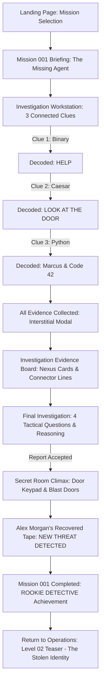

# OPERATION ZERO: Interactive Spy Investigation Game

**OPERATION ZERO** is a browser-based, cinematic spy thriller investigation game built with vanilla HTML5, CSS3, and JavaScript. Players step into the role of a newly recruited intelligence operative investigating the mysterious disappearance of Agent Alex Morgan and uncovering an internal conspiracy connected to "Shadow Protocol".

---

## 🎮 Complete Mission Progression Flow



---

## 🕵️ Key Features & Narrative Architecture

1. **Cinematic Spy Landing Interface**
   - Immersive obsidian & dark navy command center with cyan (`#00f3ff`) and crimson (`#ff3366`) accents.
   - Real-time HTML5 Canvas particle & surveillance radar network responding to cursor movement.
   - Procedural Web Audio API sound synthesizer (classified folder swooshes, terminal typing clicks, cipher decryptions, access granted/denied alerts, keypad DTMF beeps, heavy pneumatic blast door unlock, and victory fanfare).
   - Interactive Level Selection:
     - **LEVEL 01 – THE MISSING AGENT**: Available beginner cyber espionage mission.
     - **LEVEL 02 – THE STOLEN IDENTITY**: Locked classified preview ("A mysterious identity has appeared inside the agency database. Someone is erasing the identities of intelligence officers.")

2. **Classified Mission Briefing Screen**
   - Authentic intelligence dossier presentation with red `TOP SECRET // RESTRICTED` stamp.
   - Dynamic typewriter text animation with fast-forward capability.
   - Berlin, Germany operation details, threat level indicator, and suspect roster cards (Daniel, Sarah, Marcus).

3. **Three Interconnected Cryptographic Puzzles**
   - **Clue 01 – The Binary Message**:
     - Raw Packet: `01001000 01000101 01001100 01010000`
     - Solution: `HELP`
     - Narrative Reveal: *"A distress signal has been recovered."*
     - Educational debrief on base-2 binary bytes and ASCII numeric character mappings.
     - Interactive ASCII Binary Matrix drawer.
   - **Clue 02 – The Secret Alphabet**:
     - Caesar Cipher text: `ORRN DW WKH GRRU`
     - Solution: `LOOK AT THE DOOR`
     - Narrative Reveal: *"Alex may have hidden something behind a secure door."*
     - Educational debrief on Caesar substitution ciphers (3-letter reverse shift).
     - Interactive Caesar Shift Wheel reference table.
   - **Clue 03 – The Python Evidence**:
     - Realistic code editor panel with window controls, line numbers, and syntax highlighting.
     - Sandboxed terminal simulator: players can click **"EXECUTE SCRIPT"** to observe live output:
       `Suspect found: Marcus`
     - 3-question multiple-choice quiz testing understanding of Python dictionaries, `for` loops (`items()`), and `if` conditions.
     - Critical Finding: *"Marcus's credentials match the access code. Matching the code makes Marcus a primary suspect, but it does NOT prove that he is the mastermind."*

4. **All Evidence Collected Transition**
   - Cinematic interstitial modal automatically unlocks after Clue 3.
   - Displays all 3 gathered intelligence fragments:
     - Binary Message: `HELP`
     - Secret Alphabet: `LOOK AT THE DOOR`
     - Python Evidence: `Marcus — Access Code 42`
   - Glowing button: **"CONTINUE INVESTIGATION ➔"**.

5. **Investigation Evidence Board**
   - Dedicated tactical evidence board linking all 3 recovered clues.
   - Shows the logical sequence:
     - `HELP` was Alex's final distress signal.
     - `LOOK AT THE DOOR` indicates the physical location of the hidden evidence.
     - `Code 42` is associated with Marcus's credentials.
   - Interactive clickable evidence cards opening detailed intelligence inspection drawers.
   - Action button: **"START FINAL INVESTIGATION ➔"**.

6. **Final Investigation (Player Decision)**
   - 4-Question comprehensive dossier submission:
     - Question 1: Who is your primary suspect? (**Marcus**)
     - Question 2: Where should you investigate? (**The Door**)
     - Question 3: What is the secret access code? (**42**)
     - Question 4: Why do you suspect this person? (Reasoning explanation evaluating Marcus and the access credentials)
   - Intelligent validation engine providing helpful hints without immediately spoiling solutions.
   - Confirmation: **"INVESTIGATION REPORT ACCEPTED"**.

7. **Secret Room Climax & Alex Morgan's Recording**
   - Interactive digital keypad entering `4` ... `2` ... `GRANTED` with audio DTMF chirps.
   - Mechanical bolt slide and sliding dual blast doors with pneumatic audio effects.
   - Clandestine intelligence room revealed with recovered audio reel-to-reel recorder and visualizer waves.
   - Playable transmission audio with typewriter transcript:
     > *"Agent, if you're hearing this, you've found the right location.*
     > 
     > *The evidence was deliberately left behind. Marcus had access to the system, but he wasn't working alone.*
     > 
     > *Someone much higher inside the agency is controlling Shadow Protocol.*
     > 
     > *I don't know who to trust anymore.*
     > 
     > *Find the truth. Don't let them silence you."*
   - Critical plot revelation banner: **NEW THREAT DETECTED**.

8. **Mission Completion Screen & Rookie Detective Badge**
   - Professional game-style mission report:
     - Clues solved: `3/3`
     - Investigation status: `Successful`
     - Primary suspect identified: `Marcus`
     - Secret room discovered: `Yes`
     - XP earned: `500 XP`
     - Achievement unlocked: **ROOKIE DETECTIVE** (with custom gold starburst badge).
   - Button: **"RETURN TO OPERATIONS"** returning to headquarters.

9. **Persistence & Reset Controls**
   - Comprehensive `localStorage` management storing clue completion, evidence notebook, final report, secret room unlock, XP, and badges.
   - Tactical **"RESET PROGRESS"** purge button with confirmation modal.
   - Audio mute/unmute toggle preserved across page reloads.

---

## 🚀 How to Run

Open `index.html` in any modern web browser:
- Double-click [index.html](file:///c:/Users/Rayyan/Desktop/code/web%20dev/Projects/SpyGame/index.html) in your file explorer, OR
- Serve with a local HTTP server:
  ```bash
  python -m http.server 8000
  ```
  Then visit `http://localhost:8000` in your browser.
